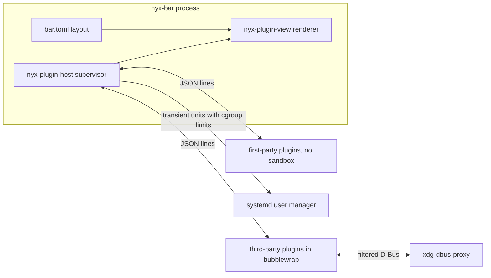

# Nyx Bar

## Approach

The bar is a host. It draws one layer-shell window per monitor, applies the theme, hides for fullscreen apps and lays items out. Every item, including workspaces and the clock, comes from a plugin: a separate program that sends JSON over stdout and receives events on stdin. Adding, removing or editing a plugin never needs a bar rebuild, and a crashing plugin only takes down its own items.

The new repository is `~/Projects/nyx-bar`, laid out like nyx-dock and pinned to the same `nyx-core` and `nyx-design` revisions. Keeping the same pins means `nyx-packages` needs no new `outputHashes`. This plan is copied into it as `docs/PLAN.md`.

The plugin system is shared with Control Center and desktop widgets. Their plans are in `nyx-control-center/docs/PLUGIN_PLAN.md` and `nyx/docs/desktop/DESKTOP_WIDGETS_PLAN.md`. The shared crates start in this repo. The Control Center plan moves them to `nyx-core` and `nyx-design`, following the rule in `nyx/docs/desktop/ARCHITECTURE.md` §10: a framework moves once it has a second user.



## Shared crates

These lived in this repo's `crates/` until 2026-11-03; now `nyx-plugin-view` is in
[nyx-design](https://github.com/design-nexus/nyx-design) and the rest in
[nyx-core](https://github.com/design-nexus/nyx-core):

- `nyx-plugin` (no GTK): manifests, discovery, `plugins.toml` (enabled parts and permission grants), installing, the index, and editing host layout files with `toml_edit`. The `nyx-plugin` command is built on it.
- `nyx-plugin-protocol`: serde message types. The views, patches, menus, popovers and drawing nodes are shared by every kind; bar-specific messages live in a `bar` module.
- `nyx-plugin-host` (no GTK): the supervisor, transient systemd units and limits, the bubblewrap sandbox, the shared D-Bus proxy, host-command checks, message limits and cgroup metrics.
- `nyx-plugin-view` (GTK): renders views, menus and popovers, scopes plugin CSS, draws vector nodes and shows shared-memory frames.
- `nyx-plugin-sdk` (Rust, for plugin authors), plus `sdk/python/nyx_plugin.py`.

## Plugins

**Kinds and parts.** A manifest lists `kinds`: `bar` now, with `control-center` and `desktop` handled by those hosts' own plans. Each kind can offer several parts (items). The user chooses which parts to use, at install and at any time later. The choices go in `~/.config/nyx/plugins.toml`, which every host reads and watches:

```toml
[enabled."nyx.weather"]
bar = ["now"]
control-center = ["tile"]
desktop = []

[grants."acme.ping"]             # written when the user approves permissions
network = true
hash = "sha256:…"                # of the [permissions] table that was approved
```

- A kind missing from `enabled` means "use the manifest's defaults". An empty list means none.
- Each host's own layout file only says where parts go.
- Parts chosen for a host that isn't installed, or doesn't load plugins yet, are kept until it does.

**Locations.** Each plugin is a folder `<dir>/<id>/` holding a `plugin.toml` and its files. When two folders have the same ID, the later one in this list wins:

1. `$XDG_DATA_DIRS/nyx/plugins/`: packaged plugins (on NixOS, `/run/current-system/sw/share/nyx/plugins/`). Trusted.
2. `~/.local/lib/nyx/plugins/`: first-party plugins installed by `install.sh` on Omarchy, replaced on each install. Trusted.
3. `~/.local/share/nyx/plugins/`: plugins added with `nyx plugin add`, linked with `nyx plugin link`, or written by the user. Third-party: sandboxed and under strict limits.

Hosts watch all three directories with GIO file monitors. A new plugin folder appears straight away, a removed one disappears, and an edited one restarts.

**Manifest** (`plugin.toml`). The field names match Glimpse's `plugin.toml` (`api_version`, `exec` as an argument array, `needs`, `[permissions]`), so Glimpse can join as another kind later without renaming anything.

```toml
id = "nyx.weather"                 # letters, digits, dots, dashes
name = "Weather"
version = "1.0.0"
author = "Design Nexus"
license = "MIT"
description = "Current conditions and temperature."
api_version = 1
kinds = ["bar", "control-center", "desktop"]
exec = ["sh", "weather.sh"]        # default for every kind; no shell evaluation
needs = ["nyx-weather"]            # skipped, and flagged by check, if missing

[permissions]                      # third-party only; trusted plugins ignore it
network = false
read = []                          # extra paths, read-only
session_talk = []                  # D-Bus names on the session bus
system_talk = []                   # D-Bus names on the system bus
host_commands = [["nyx-weather", "--toggle"]]  # exact argv the host may run
desktop = false                    # receive Hyprland state from the host
windows = false                    # open its own windows (Wayland socket)
frames = false                     # shared-memory frames

[artifacts]                        # prebuilt programs, checked by hash
x86_64-linux = { url = "https://…/weather-1.0.0.tar.zst", sha256 = "…" }

[limits]                           # requests; capped for third-party plugins
memory = "64M"

[bar]
mode = "interval"                  # or "stream"
interval = 600                     # seconds; runs line up with the wall clock
section = "right"
per_monitor = false
[[bar.items]]
id = "now"
name = "Current conditions"
default = true
[[bar.items]]
id = "forecast"
name = "Tomorrow's forecast"
default = false

[control-center]                   # same shape; may set its own exec
[[control-center.items]]
id = "tile"
name = "Weather tile"
default = true

[desktop]
[[desktop.items]]
id = "card"
name = "Forecast card"
default = false

[settings]                         # defaults; users override them per host
units = "metric"
```

**Modes:**

- `stream`: a long-running process. It pushes updates whenever its data changes and handles events on stdin.
- `interval`: the host runs the program on a timer and reads what it prints, and the program exits, so nothing stays running. Clicks use the item's `on_click` command arrays. Plain text output with no JSON is accepted as the item's text.

**Protocol v1** (JSON lines, in `nyx-plugin-protocol`):

- Host to plugin:
  - `hello`: API version, kind, settings, monitors, theme mode, granted permissions, and the frame socket path when `frames` is granted.
  - `monitors`: the monitor list, sent again when it changes.
  - `settings`: new settings.
  - `visible`: whether the plugin's parts are currently visible, so it can pause.
  - `desktop`: Hyprland workspace and window state, only with the `desktop` grant.
  - `event`: the item ID, the kind (`click`, `scroll`, `action`, `popover_open`, `popover_close`), the button, the scroll direction or control value, the monitor, and for clicks an `anchor`.
- Plugin to host:
  - `item`: an ID, an optional monitor, a `view`, `tooltip`, `visible`, and `on_click`, `on_right_click`, `on_scroll_up` and `on_scroll_down` command arrays. A simple item can give `icon`, `text`, `badge` and `progress` instead of a view.
  - `patch`: changes properties of nodes in an item's view by node ID.
  - `menu` and `popover`.
  - `remove` and `log`.
- When a plugin crashes, the host restarts it with backoff (1 s, 2 s, 4 s and so on, up to 60 s). Its items hide while it's down.

## Drawing

Items and popovers can be drawn in four ways, from cheapest to most expensive, and a plugin can mix them in one item.

1. **Layout tree.** A `view` is a tree of nodes. Each node has an optional `id` (for `patch`), a `class` list, and `hover` and `pressed` property sets, which the host swaps in itself.
   - Containers: `box` (horizontal or vertical, with spacing and alignment), `overlay`, and `stack` (with slide or fade transitions).
   - Content: `label` (Pango markup), `icon`, `image` (file path or base64), `badge`, `progress`, `graph` (line or bars), `spinner`, `vector` and `frame`.
   - Popover controls: `row`, `toggle`, `slider`, `button`, `entry`, `separator` and `scroll`.
   - Colours are Nyx theme tokens by name; hex is allowed but discouraged. Each node can set width, height, margin and font size, capped at the bar height for inline items.
2. **Plugin CSS.** A `style.css` whose selectors the host prefixes with `.plugin-<id>`. It can use theme colours, transitions and `@keyframes` animations. Animations pause while the bar is hidden. The user's `~/.config/nyx/bar.css` loads last.
3. **Vector drawing.** A `vector` node holds SVG, or commands: `path`, `line`, `arc`, `circle`, `rect`, `text`, gradients, `fill`, `stroke` and `transform`. The host draws it with GTK snapshots, using `rsvg` for SVG. Updates are coalesced to the display's frame rate.
4. **Shared-memory frames** (needs the `frames` grant).
   - The host passes double-buffered ARGB8888 `memfd` buffers over a Unix socket that is mounted into the sandbox.
   - The plugin draws into a buffer and sends `frame_ready`.
   - The host stops asking for frames while the item is hidden or off screen.
   - The SDK's `FrameSurface` handles all of this.

**Plugin windows** (needs the `windows` grant for third-party plugins). Click events carry an `anchor` (monitor, x, width and bar height) so a plugin can open its own layer-shell window under its item, using the SDK's `popup_at`. Plugin windows implement `Panel1` from `nyx-desktop`, so they close each other along with Control Center and Notification Center.

## Security

This follows Glimpse's model (`nyx-glimpse/apps/glimpse/PLUGIN_API.md`).

**Trusted** plugins come from packages or first-party installs. They run without a sandbox, under the limits in their manifest, which are capped by a system maximum.

**Third-party** plugins are everything in `~/.local/share/nyx/plugins/`.

- They always run in bubblewrap. If bubblewrap isn't available, they can't be enabled.
- The sandbox gets:
  - `--unshare-all`, plus `--share-net` only with `network`;
  - read-only `/usr`, `/nix/store`, and the parts of `/etc` that programs need (certificates, fonts, `localtime`);
  - its own plugin folder, read-only;
  - a writable data folder, `~/.local/share/nyx/plugin-data/<id>/`, passed as `$NYX_PLUGIN_STORAGE`;
  - the paths listed in `read`, read-only;
  - a private `/tmp`, plus `/proc` and `/dev`;
  - `--die-with-parent`, `--new-session`, and a seccomp filter that blocks `ptrace`, `mount`, keyring calls and the like.
- It gets no home folder, no Hyprland sockets, and no Wayland socket unless `windows` is granted.
- **D-Bus:** one `xdg-dbus-proxy` process serves every plugin, each with its own socket and filter that only allows the names in `session_talk` and `system_talk`. A plugin with no D-Bus names gets no bus at all.
- **Commands:**
  - A third-party plugin can't make the host run arbitrary commands. `on_click` and the other command arrays must match an entry in `host_commands` exactly, or the host refuses them and logs it.
  - Commands the plugin runs itself stay inside its sandbox.
- **Hyprland:** with `desktop`, the host forwards read-only workspace and window state. Any action, such as focusing a workspace, has to go through `host_commands`.

**Approval:**

- `nyx plugin add` shows each requested permission in plain words, for example "can use the network" or "can talk to NetworkManager on the system bus (it can change network settings)", and asks for approval.
- Grants are saved in `plugins.toml` together with a hash of the approved permissions.
- When an update changes the permissions, the plugin stays disabled until they're approved again.
- A rollback restores the previous version disabled, so its grants can be reviewed again.

**Installing never runs the plugin's code:**

- No install scripts or build steps run.
- Script plugins run with interpreters from `needs`.
- Compiled plugins ship `[artifacts]`: per-architecture archives whose `sha256` is checked. Index entries pin that hash too.
- `nyx plugin pack` builds the archive for authors.

**Cost.** Measured on this laptop:

- Starting a process in bubblewrap adds about 2.5 ms (0.4 ms plain, 2.9 ms sandboxed). Long-running plugins pay this once.
- A sandboxed program runs at full speed.
- The shared proxy costs about 3 to 4 MB, and the bubblewrap parent about 1 MB per plugin.
- Trusted plugins skip all of this.

## Resource limits

Every plugin runs in its own transient systemd user unit, `nyx-plugin-<kind>-<id>.service`, started with `StartTransientUnit`. Its cgroup covers the sandbox and everything the plugin starts. This machine delegates the `cpu`, `memory` and `pids` controllers to the user manager (checked under systemd 262). Where the CPU controller isn't delegated, the host falls back to `Nice` plus a CPU-time watchdog.

| Limit | Default for third-party plugins |
| --- | --- |
| Memory (`MemoryMax`, with `MemoryHigh` at 80%) | 128 MB |
| CPU (`CPUQuota`) | 10% of one core |
| Processes and threads (`TasksMax`) | 32 |
| Priority (`Nice`, `IOWeight`) | 10 and 50 |
| Messages | 30 a second, coalesced |
| Message size | 256 KB, or 2 MB for images |
| Vector drawing | 5,000 commands or SVG elements |
| Frames | 30 fps, at most bar height by 400 px; 60 fps if the user allows it |
| Popover size | 480 by 640 px |
| Items | 16 per plugin, per monitor |
| Interval runs | at least 5 s apart, killed after 10 s |
| Infinite CSS animations | 4 per plugin |

- The user can change limits per plugin in the host's config: `[plugins."<id>".limits]` in `bar.toml`.
- Messages over the rate limit are coalesced, and a warning is logged.
- A plugin over its memory limit is killed and restarted with backoff.
- After five crashes or kills in ten minutes, the plugin is disabled. The user gets a desktop notification, and `nyx plugin enable <id>` turns it back on.

## The bar

**Layout** (`~/.config/nyx/bar.toml`):

```toml
left = ["nyx.workspaces"]
center = ["nyx.clock"]
right = ["nyx.weather", "nyx.stats", "nyx.system/network", "nyx.system/bluetooth",
         "nyx.system/volume", "nyx.system/battery", "nyx.panels/notifications",
         "nyx.panels/control-center"]

[plugins."nyx.weather"]
units = "imperial"

[monitors."HDMI-A-1"]
right = ["nyx.clock"]
```

An entry is either a plugin (all its enabled items) or `plugin/item`. Enabled items that `bar.toml` doesn't place go to their manifest's `section`.

**Host D-Bus interface** `io.github.design_nexus.nyx.Bar1`:

- `ListPlugins`: ID, source, trust, state, restarts, grants, limits, and memory and CPU from the plugin's cgroup. Interval plugins report the average time per run.
- `Reload`, `RestartPlugin(id)` and `EnablePlugin(id)`.

**Code**, in `crates/nyx-bar-core` (no GTK) and `apps/bar`:

- `config.rs`: the layout, per-monitor rules and settings.
- `hide.rs`: hides on true fullscreen (`fullscreen == 2`); maximized windows keep the bar.
- `main.rs`: `--only <connector>` (or `NYX_BAR_ONLY`, which also makes the app non-unique) and `NYX_BAR_DEBUG`.
- `bar.rs`:
  - per-monitor windows (namespace `nyx-bar`, `Layer::Top`, anchored top, left and right, exclusive zone set to the bar height);
  - rebuilds on hotplug like `rebuild_docks` and `new_dock` in [nyx-dock/apps/dock/src/dock.rs](nyx-dock/apps/dock/src/dock.rs);
  - Hyprland state through `nyx_desktop::watch::watch_local`.
- `theme.rs` and `style.css`: `nyx_theme::install(Style { window_class: "nyx-bar", .. })`. Solid `@theme_panel` surface; 32 px by default.
- `data/nyx-bar.service`: systemd user unit, not enabled by install.
- `install.sh`: follows the dock's pattern. It installs `nyx-bar` and `nyx-plugin` to `~/.local/bin` and the first-party plugins to `~/.local/lib/nyx/plugins/`.

## The `nyx plugin` command

`nyx-plugin` (`apps/plugin`) does all the work; both `nyx` commands pass `nyx plugin …` to it:

- On Omarchy: one line in the `nyx` script in [nyx/](nyx/).
- On NyxOS: one line in [nyxos/pkgs/nyx-cli/nyx.sh](nyxos/pkgs/nyx-cli/nyx.sh), plus its usage text.

Prompts use `gum` when it's installed and plain prompts otherwise. `--yes` skips them, and without a terminal, anything that needs confirming fails unless `--yes` is given.

- `list [--json] [--kind K]`: each plugin's source, trust, version, the parts on for each kind, its grants, and its live state, memory and CPU through each running host.
- `search TERM` and `info ID|URL`: look plugins up in the index, or show a plugin's kinds, needs, permissions, artifacts and limits.
- `add URL|NAME [--ref TAG] [parts flags] [--yes]`:
  1. Check the source. A name is looked up in the index, which gives a repo, commit and artifact hash. A URL must be `https://`, `ssh://` or `git@host:path`. URLs starting with `-`, `transport::` helpers and `file://` are refused before cloning; local folders use `link`.
  2. Clone into a staging folder, check the pinned commit, and validate it as `check` does. Download and verify `[artifacts]`. Copy the package into place, refusing symlinks. Write `.nyx-plugin.toml` with the source, ref, commit and install time.
  3. Refuse the plugin if its ID is already in use.
  4. Permission review. Shows the author, whether the index has reviewed the plugin, and each permission in plain words, then asks for approval. The approval is saved to `grants`.
  5. The parts chooser: one checklist grouped by kind, with defaults ticked and missing hosts labelled "saved for later". It uses `gum choose --no-limit` or a numbered list. A plugin with only one part just asks "Enable it?".
  6. Placement for each chosen bar item; the section defaults to the manifest's.
  - Without a terminal, flags decide:
    - `--enable` turns on the defaults;
    - `--bar[=ITEM,…]`, `--control-center[=…]` and `--desktop[=…]` pick parts;
    - `--all` and `--none` turn everything on or off;
    - with none of these, nothing is enabled.
    - Permissions are never approved without a terminal unless `--yes` is given.
- `configure [ID]`: reopens the chooser and placement.
- `update [ID] [--yes]`:
  - shows the diff (through `delta` when installed) and installs the new commit, checking it and its artifacts;
  - if the permissions changed, leaves the plugin disabled until they're approved again;
  - rolls back on failure.
  - Index plugins move to the index's new pin.
- `remove ID [--yes]`: disables the plugin, then deletes its folder and data, unlinks a linked plugin, or backs up a local folder to `.<id>.bak.<timestamp>`. Trusted plugins can only be disabled.
- `enable ID[/ITEM] [--kind K] [--section S] [--before ID | --after ID | --index N] [--monitor NAME]`, and `disable ID[/ITEM] [--kind K]`. These edit `plugins.toml` and the host layout with `toml_edit`, which keeps the user's comments.
- `clone ID [NEW_ID]`: copies a trusted plugin into the user folder to customise. A copy with the same ID overrides the original. The copy is then third-party, so it's sandboxed and needs approval.
- Authors:
  - `new ID [--rust|--sh|--py]` creates a plugin from a template.
  - `link PATH` symlinks a working folder for development. It starts disabled and is sandboxed like any third-party plugin.
  - `check PATH` validates the manifest, needs, permissions and artifacts, and does a short sandboxed protocol run.
  - `pack PATH` builds the `[artifacts]` archive and prints its hash.

**Plugin index**, in `nyxos-project/nyx-plugin-index`:

- `index.toml` entries give the ID, name, description, kinds, repo, tag, pinned commit, artifact hashes, author, licence and `reviewed`.
- The index is cached for a day in `~/.cache/nyx/plugin-index.toml`; `--refresh` downloads it again.
- CI runs `nyx plugin check` on every entry.
- Changes come through pull requests.
- URLs outside the index still work.

**SDK:**

- `nyx-plugin-sdk` (Rust; plugin authors use it as a git dependency) provides:
  - the event loop;
  - view, vector, menu and popover builders, and `patch`;
  - `FrameSurface`;
  - `popup_at` (behind the `gtk` feature);
  - data services behind features: `network`, `bluetooth`, `audio`, `power` and `mpris`. They use D-Bus names the plugin has to declare in `session_talk` or `system_talk`.
- `sdk/python/nyx_plugin.py`: a single-file module that covers the protocol and builders, using only the standard library.
- `docs/plugins.md`: the protocol, manifest, permissions and limits reference. It recommends stream mode, or intervals of 30 seconds or more, for scripts.
- `examples/hello/` is a shell plugin, and `examples/hello-py/` is the same plugin in Python.

## First-party plugins (v1)

All of these are trusted: no sandbox, with limits from their manifests.

- `nyx.workspaces` (Rust, stream, `per_monitor`): workspaces 1 to 10, shown as active, occupied or urgent. Click focuses a workspace; scrolling moves to the next or previous one. It uses `nyx-desktop`.
- `nyx.clock` (shell, interval 60): the time and date, with a popover showing the full date.
- `nyx.weather` (shell, interval 600): `nyx-weather --waybar`. Click runs `nyx-weather --toggle`; right-click opens its settings.
- `nyx.stats` (Rust, stream, every 3 s): CPU, memory, temperature and GPU, with optional inline graphs and charts in the popover. Click runs `nyx-activity --toggle`.
- `nyx.media` (Rust, stream): MPRIS, with album art and a popover for play and pause, next and previous, and seek. Hidden when nothing is playing.
- `nyx.tray` (Rust, stream): StatusNotifierItem.
  - It serves `org.kde.StatusNotifierWatcher` when nothing else does, and otherwise registers only as a host, as on Omarchy where Quickshell owns the watcher.
  - Icons come from the icon name or the pixmap. Click calls `Activate`, and the DBusMenu becomes a bar menu.
- `nyx.system` (Rust, stream), with four items:
  - `network`: NetworkManager;
  - `bluetooth`: BlueZ;
  - `volume`: `pactl subscribe` and `wpctl`, with a slider and mute, and 5% scroll steps;
  - `battery`: UPower, hidden when there's no battery.
- `nyx.panels` (Rust, stream):
  - `notifications`: a bell with an unread badge and Do not disturb, opening `nyx-notification-center --toggle`;
  - `control-center`: highlighted while the panel is open (from `Panel1` `Opened`), opening `nyx-control-center --toggle`.
- Clicks match the current `design-nexus.status` widget. A plugin whose `needs` are missing is skipped.
- Six processes stay running: workspaces, system, stats, panels, media and tray. The clock and weather only run on their timers.
- Measured at test time with `nyx plugin list` and `smaps_rollup`, reporting each process's private memory, PSS and RSS. Your architecture doc measured a minimal GTK4 layer-shell process at 127 MiB RSS but only about 33 MiB private, so private memory is the fair comparison with Quickshell's 352 MB RSS, not RSS.

## Testing on the host

- `cargo test`: protocol round trips, manifest and layout parsing, the grant hash, the backoff schedule, and a fake plugin driven through the supervisor in a sandbox.
- **Bar checks.** Use a headless output at -20000,-20000 following the screenshot rule, `nyx-bar --only HEADLESS-n`, scratch XDG directories, and `grim -o` at 1280x800 and at a narrow width. Then confirm:
  - a plugin added or removed while the bar runs shows up or disappears;
  - a crashing plugin only hides its own item;
  - the bar hides while a window is fullscreen;
  - each drawing mode works: a layout with hover, a CSS pulse, a vector ring, and 30 fps frames, all paused while hidden;
  - `popup_at` windows open in place and close each other;
  - the tray works with a test app, and media with a test MPRIS player.
- **Limits.** Test plugins go over memory, CPU, message rate and SVG size. Confirm the bar stays responsive, each plugin is throttled or killed, and it's disabled with a notification after five kills.
- **Sandbox.** A third-party test plugin tries each of these, and each is refused:
  - reading `~/.ssh`;
  - using the network without `network`;
  - calling an undeclared D-Bus name;
  - running an `on_click` that isn't in `host_commands`;
  - opening a window without `windows`.
- **`nyx plugin`.** Run against a local `git daemon` and a test index:
  - `add` refuses unsafe URLs, a mismatched pin and a bad artifact hash;
  - the permission review and the parts chooser save exactly what was chosen;
  - `update` with new permissions leaves the plugin disabled until they're approved;
  - a bad update rolls back;
  - `enable` and `disable` keep comments;
  - `remove` and `clone` work as described.
- **Install.** Run `./install.sh </dev/null` and confirm fresh timestamps on `~/.local/bin/nyx-bar` and `~/.local/bin/nyx-plugin`. Add the `plugin` line to the Omarchy `nyx` script in `~/Projects/nyx`, reinstall it, and run `nyx plugin list`.
- The bar isn't started on Ken's real monitors. Omarchy's bar stays.

## NyxOS VM

- Coordinate with the other session first: `nyx-packages` has uncommitted work. Wait for a clean tree, or hand these steps over.
- Ask Ken before creating `design-nexus/nyx-bar` and `nyxos-project/nyx-plugin-index` on GitHub and pushing.
- In `nyx-packages`, add `pkgs/nyx-bar.nix` and a `nyx.bar.enable` module:
  - `nyx-bar` and `nyx-plugin` go in `bin/`, with `git`, `bubblewrap` and `xdg-dbus-proxy` on their `PATH`;
  - the plugins go in `share/nyx/plugins/`, with `wpctl`, `pactl` and `nyx-weather` wrapped in;
  - the module starts the user service with the graphical session.
- Set `nyx.bar.enable = lib.mkDefault true` in [nyxos/modules/nixos/apps.nix](nyxos/modules/nixos/apps.nix), and update the "temporary" comment in [nyxos/modules/home/hyprland.nix](nyxos/modules/home/hyprland.nix).
- Add `plugin` to [nyxos/pkgs/nyx-cli/nyx.sh](nyxos/pkgs/nyx-cli/nyx.sh).
- On NixOS, the sandbox binds `/nix/store` and `/run/current-system/sw` read-only in place of `/usr`.
- Rebuild the VM with `scripts/dev-vm` and check the bar and a sandboxed test plugin on its display.
